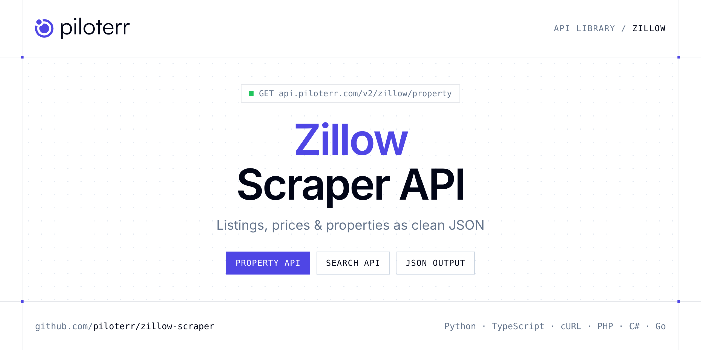

<p align="center">
  <a href="https://www.piloterr.com"></a>
</p>

# Zillow Scraper API

[](https://discord.gg/CFj3ph8aHU) [](https://app.piloterr.com) [](https://app.piloterr.com/openapi) [](LICENSE)

The **Piloterr Zillow Scraper API** lets you extract public data from Zillow as **clean, structured JSON** — no proxies, headless browsers or HTML parsing to maintain. Endpoints available in production:

- **Zillow Property API** — Extract full property details from a Zillow homedetails URL, including specs, photos, schools, tax history, and agent attribution.
- **Zillow Search API** — Search Zillow listings from a search or map URL and retrieve prices, beds, baths, coordinates, and listing status.

Use it for property price monitoring, market analytics, investment sourcing or rental yield models.

| Endpoint | Path | Credits | What you get |
|---|---|---|---|
| [Zillow Property API](#zillow-property-api) | `/v2/zillow/property` | 3 | Extract full property details from a Zillow homedetails URL, including specs, photos, schools, tax history, and agent attribution. |
| [Zillow Search API](#zillow-search-api) | `/v2/zillow/search` | 3 | Search Zillow listings from a search or map URL and retrieve prices, beds, baths, coordinates, and listing status. |

## Table of contents

- [How it works](#how-it-works)
- [Zillow Property API](#zillow-property-api)
- [Zillow Search API](#zillow-search-api)
- [Code examples in other languages](#code-examples-in-other-languages)
- [Practical use cases](#practical-use-cases)
- [Why Piloterr?](#why-piloterr)
- [FAQ](#faq)
- [Related scrapers](#related-scrapers)
- [Support](#support)

## How it works

1. **Create a free Piloterr account** and copy your API key from the [dashboard](https://app.piloterr.com).
2. **Send a `GET` (or `POST`) request** to `https://api.piloterr.com/v2/...` with the header `x-api-key: YOUR_API_KEY`.
3. **Receive structured JSON** — Piloterr handles rendering, proxies, retries and parsing.

```bash
export PILOTERR_API_KEY="your-api-key"
pip install requests        # Python
# TypeScript: Node.js 18+ (native fetch), run with `npx tsx file.ts`
```

> Every endpoint accepts both `GET` (query string) and `POST` (JSON body with the same fields).

## Zillow Property API

Extract full property details from a Zillow homedetails URL, including specs, photos, schools, tax history, and agent attribution.

`GET | POST https://api.piloterr.com/v2/zillow/property` · **3 credits per request** · [Full reference](https://app.piloterr.com/openapi)

### Request parameters

| Parameter | Type | Required | Description |
|---|---|---|---|
| `query` | string | ✅ | Full Zillow homedetails URL. |

### Python example

```python
import json
import os
import requests

response = requests.get(
    "https://api.piloterr.com/v2/zillow/property",
    headers={"x-api-key": os.environ["PILOTERR_API_KEY"]},
    params={
        "query": "https://www.zillow.com/homedetails/20-Kyle-Ct-Staten-Island-NY-10312/32361983_zpid/",
    },
    timeout=60,
)
response.raise_for_status()
data = response.json()

print(json.dumps(data, indent=2, ensure_ascii=False)[:2000])
```

### TypeScript example

```typescript
type ZillowProperty = {
  id?: string;
  city?: string;
  zpid?: number;
  mlsid?: string;
  price?: number;
  state?: string;
  county?: string;
  photos?: {
    url?: string;
    caption?: unknown;
    subject_type?: unknown;
    mixed_sources?: {
      jpeg?: Record<string, unknown>[];
      webp?: Record<string, unknown>[];
    };
  }[];
  address?: {
    city?: string;
    state?: string;
    zipcode?: string;
    community?: unknown;
    subdivision?: string;
    neighborhood?: unknown;
    street_address?: string;
  };
  country?: string;
  hdp_url?: string;
  pals_id?: string;
  schools?: {
    link?: string;
    name?: string;
    grades?: string;
    rating?: number;
    distance?: number;
  }[];
  zipcode?: string;
  bedrooms?: number;
  currency?: string;
  latitude?: number;
  lot_size?: number;
  bathrooms?: number;
  home_type?: string;
  longitude?: number;
  zestimate?: number;
  reso_facts?: {
    cooling?: string[];
    heating?: string[];
    stories?: unknown;
    basement?: string;
    bedrooms?: number;
    lot_size?: string;
    bathrooms?: number;
    has_garage?: boolean;
    year_built?: number;
    living_area?: string;
    parking_features?: string[];
  };
  year_built?: number;
  description?: string;
  [key: string]: unknown;
};

const params = new URLSearchParams({
  "query": "https://www.zillow.com/homedetails/20-Kyle-Ct-Staten-Island-NY-10312/32361983_zpid/",
});

const response = await fetch(`https://api.piloterr.com/v2/zillow/property?${params}`, {
  headers: { "x-api-key": process.env.PILOTERR_API_KEY! },
});
if (!response.ok) throw new Error(`Piloterr error ${response.status}: ${await response.text()}`);

const data = (await response.json()) as ZillowProperty;

console.log(JSON.stringify(data, null, 2).slice(0, 2000));
```

<details>
<summary><b>POST variant</b></summary>

```http
POST https://api.piloterr.com/v2/zillow/property
x-api-key: YOUR_API_KEY
Content-Type: application/json

{"query": "https://www.zillow.com/homedetails/20-Kyle-Ct-Staten-Island-NY-10312/32361983_zpid/"}
```
</details>

### Output example

Example response from the API reference, abridged — real values depend on the page you scrape.

```json
{
  "id": "UHJvcGVydHk6MzIzNjE5ODM=",
  "city": "Staten Island",
  "zpid": 32361983,
  "mlsid": "501695",
  "price": 699000,
  "state": "NY",
  "county": "Richmond County",
  "photos": [
    {
      "url": "https://photos.zillowstatic.com/fp/b57fe9b7438cd7ee0a05df7753c78812-p_d.jpg",
      "caption": null,
      "subject_type": null,
      "mixed_sources": {
        "jpeg": [
          {},
          {}
        ],
        "webp": [
          {},
          {}
        ]
      }
    },
    {
      "url": "https://photos.zillowstatic.com/fp/f0ae3c55f8feaba0c3a41b4cfe9c8c9a-p_d.jpg",
      "caption": null,
      "subject_type": null,
      "mixed_sources": {
        "jpeg": [
          {},
          {}
        ],
        "webp": [
          {},
          {}
        ]
      }
    }
  ],
  "address": {
    "city": "Staten Island",
    "state": "NY",
    "zipcode": "10312",
    "community": null,
    "subdivision": "Staten Island",
    "neighborhood": null,
    "street_address": "20 Kyle Ct"
  },
  "country": "USA",
  "hdp_url": "/homedetails/20-Kyle-Ct-Staten-Island-NY-10312/32361983_zpid/",
  "pals_id": "479004_501695",
  "schools": [
    {
      "link": "https://www.greatschools.org/new-york/staten-island/2036-Ps-4-Maurice-Wollin/",
      "name": "Ps 4 Maurice Wollin",
      "grades": "PK-5",
      "rating": 8,
      "distance": 0.4
    },
    {
      "link": "https://www.greatschools.org/new-york/staten-island/2919-Is-75-Frank-D-Paulo/",
      "name": "Is 75 Frank D Paulo",
      "grades": "6-8",
      "rating": 8,
      "distance": 0.9
    }
  ],
  "zipcode": "10312",
  "bedrooms": 4,
  "currency": "USD",
  "latitude": 40.557384,
  "lot_size": 2773,
  "bathrooms": 3,
  "home_type": "SINGLE_FAMILY",
  "longitude": -74.19698,
  "zestimate": 695900,
  "reso_facts": {
    "cooling": [
      "A/C Unit",
      "Central Air"
    ],
    "heating": [
      "Natural Gas",
      "Other"
    ],
    "stories": null,
    "basement": "None",
    "bedrooms": 4,
    "lot_size": "2,773 sqft",
    "bathrooms": 3,
    "has_garage": true,
    "year_built": 1975,
    "living_area": "2,500 sqft",
    "parking_features": [
      "Other",
      "Attached Garage"
    ]
  },
  "year_built": 1975,
  "description": "Tucked at the end of a quiet loop in Village Greens, this is one of the rare four-bedrooms in the community.    If you know the South Sho…"
}
```

### Response fields

| Field | Type | Description |
|---|---|---|
| `id` | string |  |
| `city` | string |  |
| `zpid` | integer |  |
| `mlsid` | string |  |
| `price` | integer |  |
| `state` | string |  |
| `county` | string |  |
| `photos[]` | object[] |  |
| `photos[].url` | string |  |
| `photos[].caption` | object |  |
| `photos[].subject_type` | object |  |
| `photos[].mixed_sources` | object |  |
| `address` | object |  |
| `address.city` | string |  |
| `address.state` | string |  |
| `address.zipcode` | string |  |
| `address.community` | object |  |
| `address.subdivision` | string |  |
| `address.neighborhood` | object |  |
| `address.street_address` | string |  |
| `country` | string |  |
| `hdp_url` | string |  |
| `pals_id` | string |  |
| `schools[]` | object[] |  |
| `schools[].link` | string |  |

## Zillow Search API

Search Zillow listings from a search or map URL and retrieve prices, beds, baths, coordinates, and listing status.

`GET | POST https://api.piloterr.com/v2/zillow/search` · **3 credits per request** · [Full reference](https://app.piloterr.com/openapi)

### Request parameters

| Parameter | Type | Required | Description |
|---|---|---|---|
| `query` | string | ✅ | Full Zillow search or map results URL. |

### Python example

```python
import json
import os
import requests

response = requests.get(
    "https://api.piloterr.com/v2/zillow/search",
    headers={"x-api-key": os.environ["PILOTERR_API_KEY"]},
    params={
        "query": "https://www.zillow.com/staten-island-ny/",
    },
    timeout=60,
)
response.raise_for_status()
data = response.json()

print(json.dumps(data, indent=2, ensure_ascii=False)[:2000])
```

### TypeScript example

```typescript
type ZillowSearch = {
  results?: {
    id?: string;
    area?: number;
    beds?: number;
    list?: boolean;
    zpid?: string;
    baths?: number;
    pgapt?: string;
    price?: string;
    sgapt?: string;
    address?: string;
    img_src?: string;
    pals_id?: string;
    lat_long?: {
      latitude?: number;
      longitude?: number;
    };
    has_image?: boolean;
    zestimate?: number;
    detail_url?: string;
    broker_name?: string;
    status_text?: string;
    status_type?: string;
    address_city?: string;
    has3_d_model?: boolean;
    address_state?: string;
    address_street?: string;
    address_zipcode?: string;
    country_currency?: string;
    [key: string]: unknown;
  }[];
};

const params = new URLSearchParams({
  "query": "https://www.zillow.com/staten-island-ny/",
});

const response = await fetch(`https://api.piloterr.com/v2/zillow/search?${params}`, {
  headers: { "x-api-key": process.env.PILOTERR_API_KEY! },
});
if (!response.ok) throw new Error(`Piloterr error ${response.status}: ${await response.text()}`);

const data = (await response.json()) as ZillowSearch;

console.log(JSON.stringify(data, null, 2).slice(0, 2000));
```

<details>
<summary><b>POST variant</b></summary>

```http
POST https://api.piloterr.com/v2/zillow/search
x-api-key: YOUR_API_KEY
Content-Type: application/json

{"query": "https://www.zillow.com/staten-island-ny/"}
```
</details>

### Output example

Example response from the API reference, abridged — real values depend on the page you scrape.

```json
{
  "results": [
    {
      "id": "32361983",
      "area": 2500,
      "beds": 4,
      "list": true,
      "zpid": "32361983",
      "baths": 3,
      "pgapt": "ForSale",
      "price": "$699,000",
      "sgapt": "For Sale (Broker)",
      "address": "20 Kyle Ct, Staten Island, NY 10312",
      "img_src": "https://photos.zillowstatic.com/fp/b57fe9b7438cd7ee0a05df7753c78812-p_e.jpg",
      "pals_id": "479004_501695",
      "lat_long": {
        "latitude": 40.557384,
        "longitude": -74.19698
      },
      "has_image": true,
      "zestimate": 695900,
      "detail_url": "https://www.zillow.com/homedetails/20-Kyle-Ct-Staten-Island-NY-10312/32361983_zpid/",
      "broker_name": "Listing by: Real Broker NY LLC",
      "status_text": "House for sale",
      "status_type": "FOR_SALE",
      "address_city": "Staten Island",
      "has3_d_model": true,
      "address_state": "NY",
      "address_street": "20 Kyle Ct",
      "address_zipcode": "10312",
      "country_currency": "$"
    },
    {
      "id": "32325469",
      "area": 1104,
      "beds": 3,
      "list": true,
      "zpid": "32325469",
      "baths": 2,
      "pgapt": "ForSale",
      "price": "$849,900",
      "sgapt": "For Sale (Broker)",
      "address": "43 Hickory Ave, Staten Island, NY 10305",
      "img_src": "https://photos.zillowstatic.com/fp/3a517276d08c426dce24e27c116cac1a-p_e.jpg",
      "pals_id": "820001_2602944",
      "lat_long": {
        "latitude": 40.59659,
        "longitude": -74.073944
      },
      "has_image": true,
      "zestimate": 836200,
      "detail_url": "https://www.zillow.com/homedetails/43-Hickory-Ave-Staten-Island-NY-10305/32325469_zpid/",
      "broker_name": "Listing by: Homes R Us Realty of NY, Inc.",
      "status_text": "House for sale",
      "status_type": "FOR_SALE",
      "address_city": "Staten Island",
      "has3_d_model": true,
      "address_state": "NY",
      "address_street": "43 Hickory Ave",
      "address_zipcode": "10305",
      "country_currency": "$"
    }
  ]
}
```

### Response fields

| Field | Type | Description |
|---|---|---|
| `results[]` | object[] |  |
| `results[].id` | string |  |
| `results[].area` | integer |  |
| `results[].beds` | integer |  |
| `results[].list` | boolean |  |
| `results[].zpid` | string |  |
| `results[].baths` | integer |  |
| `results[].pgapt` | string |  |
| `results[].price` | string |  |
| `results[].sgapt` | string |  |
| `results[].address` | string |  |
| `results[].img_src` | string |  |
| `results[].pals_id` | string |  |
| `results[].lat_long` | object |  |
| `results[].has_image` | boolean |  |
| `results[].zestimate` | integer |  |
| `results[].detail_url` | string |  |
| `results[].broker_name` | string |  |
| `results[].status_text` | string |  |
| `results[].status_type` | string |  |
| `results[].address_city` | string |  |
| `results[].has3_d_model` | boolean |  |
| `results[].address_state` | string |  |
| `results[].address_street` | string |  |
| `results[].address_zipcode` | string |  |

## Code examples in other languages

Ready-to-run examples live in the [`examples/`](examples) folder. Each one reads your key from the `PILOTERR_API_KEY` environment variable.

| Language | Property | Search |
|---|---|---|
| cURL (Bash) | [`property`](examples/curl/property.sh) | [`search`](examples/curl/search.sh) |
| PHP | [`property`](examples/php/property.php) | [`search`](examples/php/search.php) |
| C# | [`property`](examples/csharp/Property.cs) | [`search`](examples/csharp/Search.cs) |
| Go | [`property`](examples/go/property.go) | [`search`](examples/go/search.go) |
| Java | [`property`](examples/java/PropertyExample.java) | [`search`](examples/java/SearchExample.java) |
| Ruby | [`property`](examples/ruby/property.rb) | [`search`](examples/ruby/search.rb) |
| Node.js | [`property`](examples/nodejs/property.mjs) | [`search`](examples/nodejs/search.mjs) |

## Practical use cases

- **Price monitoring** — Track asking prices and price drops per area.
- **Market analytics** — Measure inventory, days on market and price per m² / sqft.
- **Investment sourcing** — Detect undervalued properties as soon as they are listed.
- **Rental yield models** — Combine sale and rent listings to estimate yields.
- **Proptech products** — Power portals, valuation tools and alerts with structured listings.

## Why Piloterr?

- **No infrastructure** — no proxies, headless browsers or CAPTCHA solving to run yourself.
- **Structured JSON** — stable, documented fields instead of brittle HTML selectors.
- **Pay per request** — transparent credit cost per endpoint, failed requests are retried for you.
- **One API key, hundreds of sources** — Zillow plus many other e-commerce, search and company data endpoints in the [Piloterr library](https://www.piloterr.com/library).
- **Any language** — plain HTTPS + JSON, with examples for Python, TypeScript, cURL, PHP, C#, Go, Java, Ruby and Node.js.

## FAQ

### Is it legal to scrape Zillow?

Collecting publicly available data is generally allowed in many jurisdictions, but rules depend on your country, the data you collect and how you use it. Avoid personal data unless you have a lawful basis, respect the website's terms where they apply, and get legal advice for your specific use case. This is not legal advice.

### Do I need proxies or a headless browser?

No. Piloterr handles rendering, proxy rotation and retries on its side. You only send an HTTPS request with your `x-api-key` header and receive JSON.

### How much does a request cost?

Credits per call: `/v2/zillow/property` **3**, `/v2/zillow/search` **3**. See the [Piloterr website](https://www.piloterr.com) for plans.

### What data does the Zillow API return?

Each endpoint returns structured JSON: **Zillow Property** — `id`, `city`, `zpid`, `mlsid`, `price`, `state`; **Zillow Search** — `results[]`, `results[].id`, `results[].area`, `results[].beds`, `results[].list`, `results[].zpid`.

### Which languages are supported?

Any language that can make an HTTP request. This README shows Python and TypeScript; the [`examples/`](examples) folder contains cURL, PHP, C#, Go, Java, Ruby and Node.js.

## Related scrapers

- [Apartments Scraper API](https://github.com/piloterr/apartments-scraper)
- [Argenprop Scraper API](https://github.com/piloterr/argenprop-scraper)
- [Centris Scraper API](https://github.com/piloterr/centris-scraper)
- [Fotocasa Scraper API](https://github.com/piloterr/fotocasa-scraper)
- [Funda Scraper API](https://github.com/piloterr/funda-scraper)
- [Homestra Scraper API](https://github.com/piloterr/homestra-scraper)
- [All Piloterr scrapers on GitHub](https://github.com/piloterr)

## Support

- 💬 Join the [Piloterr Discord](https://discord.gg/CFj3ph8aHU) to ask questions and share what you build.
- 📚 Browse the [API reference (OpenAPI)](https://app.piloterr.com/openapi) and the [Piloterr library](https://www.piloterr.com/library).
- 🔑 [Get your API key](https://app.piloterr.com).

---

<p align="center">
  <a href="https://www.piloterr.com">
    <picture>
      <source media="(prefers-color-scheme: dark)" srcset="images/logo-dark.svg">
      
    </picture>
  </a>
  <br>
  <sub>Built by <a href="https://www.piloterr.com">Piloterr</a> — web scraping APIs for e-commerce, search, real estate and more, one API key.</sub>
</p>

<sub>Zillow is a trademark of its respective owner. This repository is not affiliated with or endorsed by Zillow. Examples are released under the MIT license.</sub>
